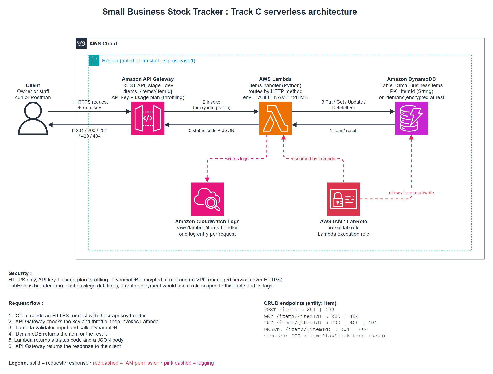

# Small Business Stock Tracker (Track C: Serverless)

AWS Cloud Computing individual project. A minimal serverless API that lets a small business owner create, read, update and delete stock items, each with a quantity and a reorder level.

- **Track:** C, Serverless (API Gateway + Lambda + DynamoDB)
- **Entity:** `Item` (one DynamoDB table, `SmallBusinessItems`)
- **Environment:** AWS Academy lab account (Lab Project: Microservices and CI/CD Pipeline Builder)

## Architecture



A client calls API Gateway over HTTPS with an API key. API Gateway invokes one Lambda function (`items-handler`), which reads and writes the DynamoDB table. Lambda runs as the lab's preset `LabRole` and writes logs to CloudWatch. The PNG has the draw.io diagram embedded, so it can be opened and edited directly in draw.io.

## CRUD endpoints

| Operation | Method and path | Success | Errors |
| --- | --- | --- | --- |
| Create | `POST /items` | `201` | `400` |
| Read | `GET /items/{itemId}` | `200` | `404` |
| Update | `PUT /items/{itemId}` | `200` | `400`, `404` |
| Delete | `DELETE /items/{itemId}` | `204` | `404` |

Full request and response details are in the [design brief](docs/design-brief.md).

## Repository layout

```
README.md
docs/        design brief and architecture diagram
src/         Lambda handler (items_handler/lambda_function.py)
tests/       local unit tests (python -m unittest discover -s tests)
scripts/     table setup (create_table.sh) and API test (test_api.sh)
evidence/    AWS screenshots and curl outputs (planned)
```

## Deployment plan

Full click-by-click steps, with the screenshot each step produces: [docs/deployment-guide.md](docs/deployment-guide.md).

1. Start the AWS Academy lab session and note the region.
2. Create the DynamoDB table `SmallBusinessItems` (partition key `itemId`, String, on-demand).
3. Create the Lambda function `items-handler` with `LabRole` and the table name as an environment variable.
4. Create the REST API with `/items` and `/items/{itemId}`, the four methods, and Lambda proxy integration; deploy to a stage.
5. Create an API key and a usage plan with throttling, and attach them to the stage.
6. Run `scripts/test_api.sh` with `API_URL` and `API_KEY` set; it calls every endpoint and saves the outputs to `evidence/`.
7. Confirm the requests appear in CloudWatch Logs.

Estimated cost is about $0.01 at project scale; see the cost estimate in the [design brief](docs/design-brief.md).

## Status

- [x] Design brief
- [x] Architecture diagram
- [x] DynamoDB table script
- [x] Lambda handler (create, read, update, delete)
- [x] API test script
- [ ] AWS evidence
