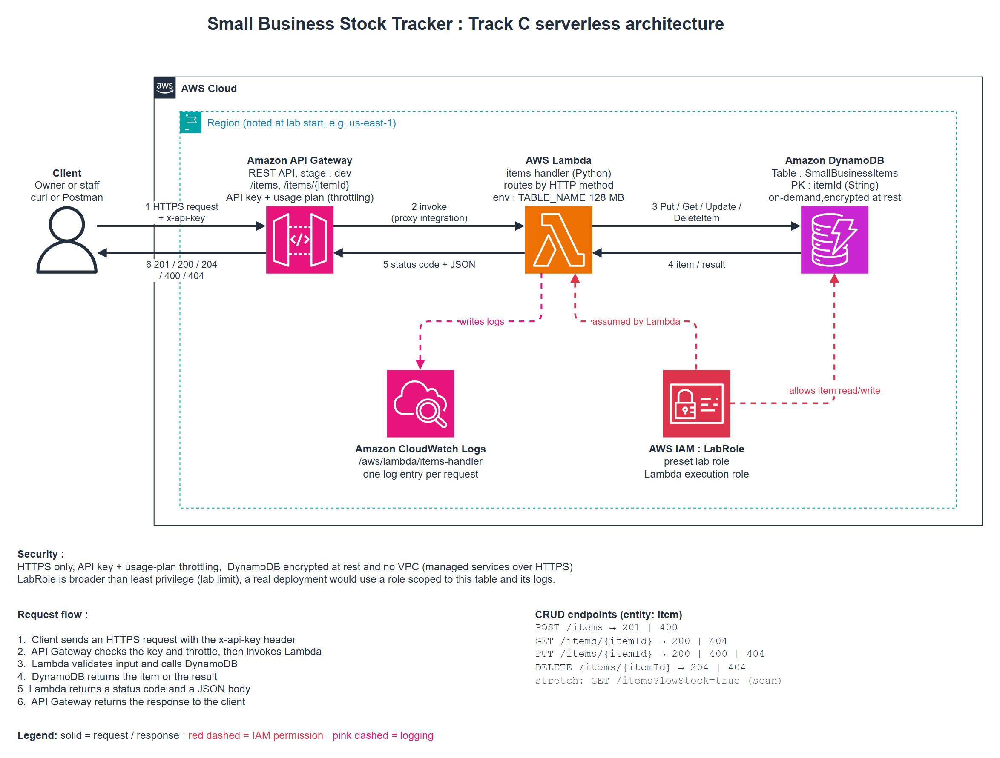

# Week 12 Design Brief: Small Business Stock Tracker (Track C Serverless)

Nov 25, 2026 · @Apa

## 1. Context and use case

Small businesses in Indonesia are digitising their payments faster than their stock records, and this project builds a minimal serverless stock tracker to close that gap.

A small business that sells physical goods needs to know what it holds and when to reorder. Many still track this on paper or in a spreadsheet. This project proposes a small cloud API where an owner or staff member creates, reads, updates and deletes stock items, each with a quantity and a reorder level.

- **Primary user:** the owner of a small business (retail, café ingredients, home-based food) who tracks stock manually today.
- **Scope:** one entity (`Item`), four CRUD endpoints, no user interface required for this stage.
- **Out of scope (future work):** low-stock alerts, multi-user accounts, barcode scanning.

## 2. Why this problem: evidence and its limits

The evidence shows that small businesses matter, that their payments are digital, and that record-keeping is a recognised gap; it does not directly measure stock-keeping in Indonesia.

| Evidence | Source | What it supports | Limit |
| --- | --- | --- | --- |
| Small businesses: 60.5% of GDP, 97% of employment, 99.7% of businesses are micro | [Katadata, 14 Oct 2026](https://katadata.co.id/finansial/makro/6acebf857b24d/umkm-sumbang-60-5-pdb-tetapi-99-7-usahanya-masih-mikro) | The user group is large and economically important | Government-stated figures reported by the press |
| QRIS: 44.86 million merchants, about 96.68% of them small businesses (Bank Indonesia, June 2026) | [Kontan, 7 Sep 2026](https://industri.kontan.co.id/news/transaksi-makin-digital-ini-strategi-pemerintah-dongkrak-bisnis-umkm) | Payments are already digital | Says nothing about stock records |
| Business record-keeping listed among the challenges still facing small businesses | [Kontan, 7 Sep 2026](https://industri.kontan.co.id/news/transaksi-makin-digital-ini-strategi-pemerintah-dongkrak-bisnis-umkm) | Records are a recognised gap | A qualitative list, not a measurement |
| 200 US small retailers (June 2025): 57% rely on manual inventory counts; 23% learn of a stockout only when a customer tries to buy | [Global Payments retail inventory report](https://www.globalpayments.com/insights/unpacking-the-truth-about-retail-inventory-report) | Manual counting causes stockouts that are found late | Vendor-sponsored, US-only, small sample: indicative only |

**Limitation stated openly:** the stockout figures come from a US vendor survey, so this brief treats them as a mechanism that is plausible for Indonesian small businesses, not as a measured Indonesian rate.

## 3. Chosen track: C (Serverless)

I decided to choose Track C, which is Serverless. It fits because a small business stock tracker has low, bursty traffic, which is where pay-per-request pricing is easiest to defend.

A 2025 study of serverless for small and medium enterprises reports [47-62% potential cost savings for variable workloads, but VMs 12-18% cheaper for sustained load](https://www.ebsco.com/articles/computer-science/78cf2c94-dc30-589f-b9ad-6b7114a5a017/serverless-architectures-for-scalable-and-cost-efficient-information-systems-in-smes), with cold starts affecting 5.7% of invocations at about 1.4 s latency. Treat these as one study's findings, not guarantees.

| Track | Pros for this project | Cons for this project |
| --- | --- | --- |
| A: EC2 + RDS MySQL | Familiar SQL model; easy to reason about | Always-on server and database cost for a near-idle workload; more patching and network setup |
| B: EC2 + Docker + ECR | Portable, reproducible packaging | Two services plus image build is more setup than a one-entity API needs |
| **C: API Gateway + Lambda + DynamoDB** | Pay per request; no server to manage; smallest setup for one entity and four endpoints | Cold-start delay on first call; AWS lock-in; limited local testing |

**Decision: Track C.** The cold-start cost is acceptable for a stock lookup that a person triggers occasionally.

## 4. Data entity: Item

One DynamoDB table, `SmallBusinessItems`, holds one `Item` per stock line, keyed by `itemId`.

| Attribute | Type | Required | Notes |
| --- | --- | --- | --- |
| `itemId` | String (partition key) | Server-set | UUID generated by the Lambda on create |
| `name` | String | Yes | Product or ingredient name |
| `quantity` | Number | Yes | Whole number, 0 or more |
| `unit` | String | Yes | For example `pcs`, `kg`, `box` |
| `reorderLevel` | Number | Yes | Whole number, 0 or more; an item is low stock when `quantity` is at or below this value |
| `createdAt` | String | Server-set | ISO 8601 UTC timestamp |
| `updatedAt` | String | Server-set | ISO 8601 UTC timestamp, changed on every update |

**Capacity mode: on-demand.** Pro: no capacity planning for an unpredictable, low workload. Con: costs more per request than provisioned capacity if traffic ever becomes steady and high.

## 5. CRUD endpoints

Four endpoints cover create, read, update and delete for `Item`, all under the `/items` path and all returning JSON.

| Operation | Method and path | Request body | Success | Errors |
| --- | --- | --- | --- | --- |
| Create | `POST /items` | `name`, `quantity`, `unit`, `reorderLevel` | `201` with the created item | `400` missing or invalid field |
| Read | `GET /items/{itemId}` | None | `200` with the item | `404` unknown `itemId` |
| Update | `PUT /items/{itemId}` | `name`, `quantity`, `unit`, `reorderLevel` | `200` with the updated item | `400` invalid field; `404` unknown `itemId` |
| Delete | `DELETE /items/{itemId}` | None | `204` no content | `404` unknown `itemId` |

**Stretch, not counted in the four:** `GET /items?lowStock=true` lists items at or below their reorder level, which is what makes the stockout story visible. Pro: directly demonstrates the use case. Con: it uses a table scan, which gets slower and costlier as the table grows, so it is acceptable only at this scale.

## 6. Architecture, data flow and security

A client calls API Gateway over HTTPS, which invokes one Lambda function that reads and writes a DynamoDB table, all under the existing LabRole and with no VPC.



Each request follows the solid arrows left to right and returns the same way; the dashed arrows show the role Lambda runs as and the logs it writes.

**Security and IAM, with trade-offs**

- **IAM role.** The AWS Academy lab environment (Lab Project: Microservices and CI/CD Pipeline Builder) limits IAM, so Lambda runs as the preset LabRole instead of a custom role (to be confirmed in the lab console, see the AWS evidence checklist in the Appendix). Pro: nothing to create or maintain. Con: LabRole is broader than least privilege; a real deployment would use a role limited to this table and to log writes.
- **Network.** No VPC: the managed services are reached over HTTPS. Pro: no NAT or subnet setup. Con: no network-level isolation, which is acceptable here because the data is only stock counts.
- **API protection.** An API key with a usage plan and throttling on the stage. Pro: cheap control against abuse. Con: a key identifies a caller but is not user authentication, so real sign-in (for example Amazon Cognito) is future work.
- **Data protection.** API Gateway endpoints use HTTPS and DynamoDB encrypts data at rest by default.

## 7. Design decisions and trade-offs

Four choices shape the build, each picked to keep the Week 12 scope small and the setup low-risk in a restricted account.

| Decision | Chosen | Pros | Cons and alternative |
| --- | --- | --- | --- |
| Lambda layout | One function (`items-handler`) routing by method | One thing to deploy, test and screenshot | Larger blast radius for a bug; one function per route gives finer permissions and metrics |
| API type | API Gateway REST API | Supports API keys and usage plans, used for throttling here | Typically costs more per request than the HTTP API type, which lacks usage plans |
| Database | DynamoDB, key-value by `itemId` | Matches access by id; no server; no schema migration | Ad-hoc queries and reports are harder than SQL; the low-stock list needs a scan |
| Deployment method | Console plus AWS CLI scripts kept in the repo | Lowest risk in a restricted lab account; every step is repeatable from the scripts | More manual than infrastructure as code; CloudFormation or SAM is the next step if the lab allows it |

## Appendix (outside the 2-page brief): deployment plan, repo and evidence

The build runs in seven steps and each step produces one piece of evidence for the submission.

**Deployment plan**

1. Start the AWS Academy lab session, open the console and note the region.
2. Create the DynamoDB table `SmallBusinessItems` (partition key `itemId`, String, on-demand).
3. Create the Lambda function `items-handler` with LabRole as its execution role and the table name as an environment variable.
4. Create the REST API with `/items` and `/items/{itemId}`, the four methods, and Lambda proxy integration; deploy it to a stage.
5. Create an API key and a usage plan with throttling, and attach them to the stage.
6. Call each endpoint with `curl` and save the outputs.
7. Open CloudWatch Logs and confirm the requests were logged.

**Cost estimate**

The lab budget is $40, and the three services cost about one cent at project scale, so the budget risk is idle hourly resources, not requests.

Assumptions: us-east-1 list prices, no free tier, Lambda at 128 MB and about 300 ms per call, items about 1 KB, half of calls are writes. Prices to be confirmed in the [AWS Pricing Calculator](https://calculator.aws/).

| Service | Unit price | Project use (~2,000 calls) | Worst case (100,000 calls) |
| --- | --- | --- | --- |
| API Gateway (REST) | $3.50 per million requests | $0.007 | $0.35 |
| Lambda | $0.20 per million requests + $0.0000166667 per GB-second | $0.002 | $0.08 |
| DynamoDB (on-demand) | $0.625 per million writes, $0.125 per million reads | $0.001 | $0.04 |
| CloudWatch Logs | $0.50 per GB ingested | $0.002 | $0.10 |
| **Total** | | **≈ $0.01** | **≈ $0.57** |

API keys and usage plans have no charge. Cost controls: leave API Gateway caching and Lambda provisioned concurrency off (both bill hourly), keep DynamoDB on-demand without point-in-time recovery or backups, stop any lab-created EC2, RDS or IDE instances between sessions, check the spent amount in the lab panel after each session, and delete the table, function and API after grading.

**Repository layout**

```
small-business-stock-tracker/
  README.md
  docs/            design brief and architecture diagram
  src/items_handler/lambda_function.py
  scripts/         create_table.sh, test_api.sh
  evidence/        screenshots and curl outputs
```

**Progressive commits (planned order)**

1. `docs: add README and design brief`
2. `docs: add architecture diagram`
3. `infra: add DynamoDB table script`
4. `feat: handler for create and read`
5. `feat: handler for update and delete`
6. `test: add API test script`
7. `docs: add AWS evidence`

**AWS evidence checklist**

- [ ] Console open in the AWS Academy lab, region visible
- [ ] LabRole selectable as the Lambda execution role (confirms the IAM assumption in section 6)
- [ ] DynamoDB table showing Active
- [ ] Lambda function page showing the role and the environment variable
- [ ] API Gateway resources and methods, plus the stage invoke URL
- [ ] `curl` outputs: create returns 201, read 200, update 200, delete 204, read after delete 404
- [ ] A CloudWatch log entry from one request
- [ ] API key and account ID hidden in every screenshot
